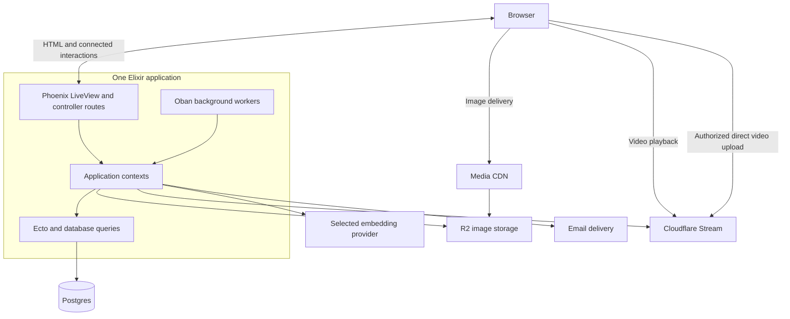

# Software architecture

## Decision

Build Tips as one Elixir/Phoenix application, organized into contexts and deployed as one application release. Use Ecto and Postgres for persistence. Adopt LiveView as the default for interactive pages, with HEEx components and conventional controller routes where needed.

Keep three logical responsibilities: presentation, business operations, and data access. Follow Phoenix's conventions to implement them. Contexts encapsulate business operations and data access; these responsibilities do not require separate projects or matching layers of wrapper modules.

## Purpose and scope

Tips lets people publish practical tips, share reviews, vote on usefulness, and discover content. The architecture should make those features straightforward to build and operate while preserving permissions, content visibility, and data consistency.

This document describes the system’s major parts, boundaries, runtime and deployment. The [frontend design](frontend-design.md) owns LiveView, pages, components and browser interactions. The [backend design](backend-design.md) owns operation orchestration and external-service coordination. The [data model](data-model.md) is the canonical schema and database-invariant specification. Ecto migrations are the executable schema.

## Design approach

### V2 direction: MCP access

An MCP server for tips is a v2 direction with no MVP requirements; see [Future MCP access (v2)](backend-design.md#future-mcp-access-v2).

### MVP design constraints

This is a greenfield MVP seeking product-market fit. Optimize for shipping complete user flows, learning from use, and changing the design quickly. Preserve agreed behavior while choosing the smallest implementation that delivers it. Backwards compatibility is not a requirement.

Accept necessary complexity when it makes the user's experience simpler. Don't make the implementation look simple by pushing its complexity onto the user. This governs the architecture, backend, data model and frontend. Evaluate a simplification locally, across affected features, and through the complete user journey: include repeated actions, waiting, recovery, accessibility and lost capabilities, not just code or state removed. Prefer proven framework, library and managed-service capabilities that absorb this work. Preserve reliable saving, recovery, clear progress and permissions when they protect the user's task; defer optional scope when its user value does not justify its total cost.

Use industry patterns as evidence for a choice, then assess their cost at Tips' scale. Prefer existing Phoenix, Ecto, Postgres, and community library capabilities. Add storage, processes, dependencies, or abstractions when a concrete flow or recurring implementation problem needs them. Keep performance limits tunable and validate them with relevant measurements. Routine reversible implementation choices do not need a separate product decision.

Module and function proposals in the design documents describe responsibilities. They are not a scaffolding checklist: start with ordinary functions and extract internal modules when cohesive logic makes the separation useful. Phoenix conventions provide a starting point that we can adapt as the product develops.

The first unit of progress is a working user flow through LiveView, a context, and Postgres.

## System structure

The MVP has two application contexts: `Tips.Accounts` for identity and account lifecycle, and `Tips.Content` for tips, reviews, votes, discovery, media, moderation, and content notifications. Extract internal helper modules as needed. Keep web interactions in `TipsWeb`; these boundaries do not introduce separate services or processes. See the [backend context boundaries](backend-design.md#agreed-context-boundaries).

The arrows show access between components, not supervision relationships. Images and GIFs upload through the application; videos upload from the browser directly to Stream. See [Managed video](backend-design.md#managed-video).

| Part | Responsibility |
|---|---|
| Phoenix web interface | Initial HTML, connected page interactions, shared components, and ordinary HTTP routes |
| Application contexts | Related business capabilities exposed through ordinary Elixir functions |
| Ecto and Postgres | Persistent data, queries, and database consistency |
| Oban background workers | Durable background work and retries using the existing Postgres database |
| External integrations | Image storage, managed video processing and delivery, embedding inference, and email delivery |

Phoenix provides the web interface. LiveViews and controllers call context functions; background workers use the same application capabilities. Presentation state belongs to the web layer, while business rules and durable changes belong to the application and database.

## Code boundaries

Organize code by related business capabilities. Contexts expose a small public API and keep their internal organization local. The web layer calls `Content.search_tips`, for example, rather than reaching into `Content.Search`. This does not require a wrapper module for every helper. The backend document defines these operations, including [bans and lifting a ban](backend-design.md#bans-and-lifting-a-ban).

Keep ordinary business work in modules and functions. Our existing Transaction Script choice fits here as an implementation pattern for operations. DDD's emphasis on clear business language is useful; a rich domain model becomes worthwhile when the rules justify it.

Start with one Mix project. Add a separate application or service when independent operation or deployment solves a demonstrated problem. The current product does not require that separation.

## Caller identity and access

Use Phoenix's application-owned scope to carry caller information from the web boundary into context operations. Keep access decisions explicit at that boundary, including reads and any future subscriptions. This follows the [Phoenix 1.8 scopes convention](https://phoenix.hexdocs.pm/1.8.0/scopes.html).

Adapt the generated ownership filters to Tips' public-content model: anonymous readers can see public content, while authors and moderators have additional permissions. A scope supplies identity and context; current permissions and guarded database writes still enforce the rules. Long-lived LiveViews must not treat an old scope as permanent permission.

Mutations and privileged reads re-admit the caller through one Accounts helper; see the [backend admission contract](backend-design.md#admission-locking-and-returned-data).

Use the generated magic-link authentication foundation already selected in the backend design. The [Phoenix 1.8 announcement](https://www.phoenixframework.org/blog/phoenix-1-8-released) directly supports that choice.

## Runtime and reliability

Retain nightly database backups in private R2 storage for seven days, using a lifecycle rule scoped only to backups. This follows a common entry-level managed-database convention, such as [Supabase Pro's seven-day retention](https://supabase.com/docs/guides/platform/backups), rather than a universal industry requirement. Use [R2 lifecycle expiration](https://developers.cloudflare.com/r2/buckets/object-lifecycles/) instead of custom retention scheduling. Keep the nightly `pg_dump` and pre-launch restore test. Seven-day retention does not reduce the potential data loss since the latest successful nightly backup and does not provide point-in-time recovery or user-facing deletion undo.

Deploy normal Phoenix releases as Docker images on a single VPS with Docker Compose. Accept a brief application interruption during deployment. Build and test the replacement image while the existing app serves traffic; then gracefully stop the old app, run migrations using the release command, start the prepared release, and check readiness. Keep Postgres running during ordinary application deployments. A failed migration or readiness check must stop the deployment from being declared successful; do not assume an older app image is compatible with a changed schema. After a failed migration the site remains down while the operator fixes forward.

Use LiveView recovery of the current URL page and useful reading position, browser draft recovery, and durable Oban job recovery after restart. Measure deployment interruption during testing rather than promising a fixed duration. Defer hot-code upgrades and overlapping app instances; revisit blue-green deployment if measured disruption warrants it. References: [Phoenix releases](https://phoenix.hexdocs.pm/releases.html), [Docker Compose production deployment](https://docs.docker.com/compose/how-tos/production/), and [Elixir's hot-upgrade tradeoffs](https://mix.hexdocs.pm/Mix.Tasks.Release.html#module-hot-code-upgrades).

Use hosted Sentry's free Developer plan alongside local application logs for production error reporting. Integrate Phoenix/LiveView exceptions through the supported SDK integration; [Durable background work](backend-design.md#durable-background-work) covers Oban job failures. Send sanitized diagnostic metadata, excluding authentication tokens, email addresses, submitted prompts/content, and uploaded media. Start with error tracking and operator email alerts; defer tracing, session replay, and custom dashboards. This is an MVP choice to reduce operational work, not a requirement of Phoenix.

The free plan currently limits user seats and event volume; review the provider's current quotas during setup and monitor consumption. Keep local logs and durable job failure state available if external reporting is unavailable or quota-limited. Sentry delivery failure must not fail a user request or business transaction. References: [Sentry pricing](https://sentry.io/pricing/) and [Elixir SDK integrations](https://sentry.hexdocs.pm/Sentry.html).

Use Sentry's included external uptime monitor to check a lightweight application-and-database health endpoint through the public Cloudflare-proxied hostname and alert the operator when it fails. The endpoint confirms Phoenix can serve a request and execute a bounded, read-only Postgres probe; return success only when both work. Exclude Stream, R2, email delivery, and embeddings from this check so optional-provider failures do not imply the entire app is down. Return no credentials or diagnostic details in the public response, and prevent caching of the health result. This complements exception reporting because a stopped app cannot report its own outage.

Operators retry selected exhausted jobs through release commands; see [Durable background work](backend-design.md#durable-background-work).

Code boundaries and process boundaries serve different purposes. Use ordinary functions for business operations and supervised processes for runtime lifecycles. A connected LiveView manages a page's temporary state; a background worker manages ongoing work. Tips and votes remain database records accessed through contexts.

Design supervision around dependency lifetimes and failure isolation, as well as startup order. Shared infrastructure must not disappear when an unrelated worker subtree restarts.

Run open-source [Oban](https://oban.hexdocs.pm/Oban.html) inside the same release, on the existing Repo and Postgres, for durable jobs, scheduled work and retries; see [Durable background work](backend-design.md#durable-background-work).

Rerun bounded search retrieval and ranking for each requested page. Use existing Postgres search data and the embedding service; the web layer retains query, filters, and page position. Accept that rankings can change between requests. No saved-order table, cache process, lifetime, or expiry-cleanup job is needed.

Postgres holds durable application state. Persist the business data and progress needed for recovery, and reconstruct temporary runtime state from it. Recovery must handle incompatible or invalid stored state deliberately; restarting alone does not repair it.

The current Tips workflows fit Postgres transactions and supervised workers. Use a GenServer only when a stateful process is needed; neither every entity nor every operation needs one.

Show a confirmed save only after the required durable write succeeds. An interrupted response can leave the outcome uncertain, so reconnects must reconcile with stored state. Detailed retry behavior belongs in the backend design.

## Web experience

Use LiveView and shared HEEx components within the Phoenix application. Public pages deliver readable initial HTML, then connect for interactions. This applies the building blocks described in Chris's [Phoenix 1.8 announcement](https://www.phoenixframework.org/blog/phoenix-1-8-released) to Tips.

Each page owns its interaction state. Use function components for shared controls and ordinary assigns for one current page. All reading lists use URL Previous/Next pagination, with no accumulated streams or seen-id sets. Search retrieval has one owner in `handle_params`: bounded synchronous initial loads, then named async work for parameter changes and pagination. Browser hooks cover local drafts, file transport and other browser capabilities. The frontend design defines the recovery and navigation details.

The [frontend design](frontend-design.md) owns page structure, navigation, forms, browser behavior, and reconnect UX. Application permissions and durable writes remain behind context APIs. The current requirements do not call for a separately deployed frontend or public JSON API.

## Development feedback

Start from the framework's generated code and evolve it for the product. Merge relevant generated agent guidance with the project's existing instructions. Chris presents simpler scaffolding and framework-specific agent guidance as productivity improvements in the [Phoenix 1.8 announcement](https://www.phoenixframework.org/blog/phoenix-1-8-released).

Use Phoenix's generated conventions and built-in testing facilities as the starting point. Validate the user journey and the application boundary, including reconnects and failed writes. Keep concurrent tests synchronized by observable events. Chris's [November 2025 test guidance](https://github.com/phoenixframework/phoenix/commit/bd3cf83824bd5e1c8899ce165b06a5b4d2ba510f) favors supervised test processes and explicit synchronization. Frontend and backend test details belong in their respective design documents.

## Deployment

Keep one VPS with Docker Compose for the Phoenix release and a pinned Postgres image containing pg_textsearch and pgvector. Search embeddings use one hosted runtime, Qwen3-Embedding-8B through OpenRouter on Nebius at 1024 dimensions; `Tips.Content.Search.EmbeddingProvider` holds its contract, and configuration selects its implementation, model and host. Eligible public document text and reader queries leave the server for inference, and a call already admitted may finish after its content is hidden. Keep one bounded client and keyword fallback, with no model registry or failover between hosts. R2 stores images and database backups; email is delivered through a provider.

Serve the application hostname through Cloudflare's proxy and restrict direct public access to the origin so edge protections cannot be bypassed. Keep Turnstile in the signup flow and verify its result on the server. Use forwarded client addresses only when needed, and trust them only through the configured proxy path. Apply the same public path to uptime checks; do not confuse the application proxy with the separate media delivery domain.

Cloudflare Stream holds private short-video attachments and R2 holds images and GIFs; see [Managed video](backend-design.md#managed-video).

Scaling decisions should follow measured constraints. Context boundaries can evolve within the application before deployment boundaries need to change.
