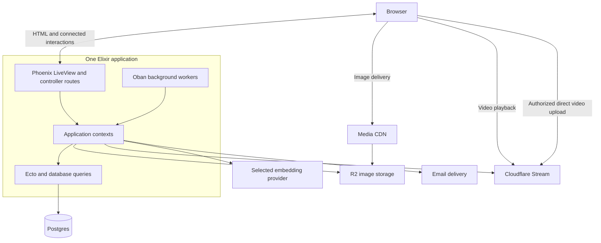

# Software architecture

Date: 2026-09-20. Status: incorporates the final UX consensus, user-effort reassessment and owner-selected review setup defaults. Implementation and integration verification remain outstanding.

## Decision

Build Tips as one Elixir/Phoenix application, organized into contexts and deployed as one application release. Use Ecto and Postgres for persistence. Adopt LiveView as the default for interactive pages, with HEEx components and conventional controller routes where needed.

Keep three logical responsibilities: presentation, business operations, and data access. Follow Phoenix's conventions to implement them. Contexts encapsulate business operations and data access; these responsibilities do not require separate projects or matching layers of wrapper modules.

This revision incorporates the consensus from the [architecture](../../brainstorm/idioms-v2-architecture-review.md), [backend](../../brainstorm/idioms-v2-backend-review.md), and [frontend](../../brainstorm/idioms-v2-frontend-review.md) reviews. Codex and Fable used José Valim-inspired and Chris McCord-inspired perspectives; neither person reviewed or endorsed this design. The source notes below preserve the earlier framework research. The review found the monolith cohesive and recommended simpler implementations within it.

## Purpose and scope

Tips lets people publish practical tips, share reviews, vote on usefulness, and discover content. The architecture should make those features straightforward to build and operate while preserving permissions, content visibility, and data consistency.

This document describes the system’s major parts, boundaries, runtime and deployment. The [frontend design](frontend-design.md) owns LiveView, pages, components and browser interactions. The [backend design](backend-design.md) owns operation orchestration and external-service coordination. The [data model](data-model.md) is the canonical schema and database-invariant specification. Ecto migrations become executable schema truth when implemented; historical measurements do not validate the revised design.

## Design approach

### V2 direction: MCP access

Explore an MCP server that lets users or AI agents search and access tips, and potentially submit tips, from their AI application or coding harness. Record this direction without designing it now; scope and implementation decisions are deferred to v2 and add no MVP requirements.

### MVP design constraints

This is a greenfield MVP seeking product-market fit. Optimize for shipping complete user flows, learning from use, and changing the design quickly. Preserve agreed behavior while choosing the smallest implementation that delivers it. Backwards compatibility is not a requirement.

Accept necessary complexity when it makes the user's experience simpler. Don't make the implementation look simple by pushing its complexity onto the user. This governs the architecture, backend, data model and frontend. Evaluate a simplification locally, across affected features, and through the complete user journey: include repeated actions, waiting, recovery, accessibility and lost capabilities, not just code or state removed. Prefer proven framework, library and managed-service capabilities that absorb this work. Preserve reliable saving, recovery, clear progress and permissions when they protect the user's task; defer optional scope when its user value does not justify its total cost.

The final [UX architecture](../../brainstorm/ux-idioms-architecture-review.md), [backend](../../brainstorm/ux-idioms-backend-review.md) and [frontend](../../brainstorm/ux-idioms-frontend-review.md) agreements are incorporated into the technical contracts, including the subsequent owner decision to prefill review setup from the tip. Earlier rejected or superseded proposals in those records are not parallel implementation choices. The design is adopted; implementation and integration verification remain outstanding.

Use industry patterns as evidence for a choice, then assess their cost at Tips' scale. Prefer existing Phoenix, Ecto, Postgres, and community library capabilities. Add storage, processes, dependencies, or abstractions when a concrete flow or recurring implementation problem needs them. Keep performance limits tunable and validate them with relevant measurements. Routine reversible implementation choices do not need a separate product decision.

Module and function proposals in the design documents describe responsibilities. They are not a scaffolding checklist: start with ordinary functions and extract internal modules when cohesive logic makes the separation useful. Phoenix conventions provide a starting point that we can adapt as the product develops.

This applies Chris's description of product-led framework development (01:35–04:01) and DurableServer's extraction from working product code (16:51–19:20) in the [supplied interview transcript](#interview-transcript). For Tips, the first unit of progress is a working user flow through LiveView, a context, and Postgres.

## System structure

The MVP has two application contexts: `Tips.Accounts` for identity and account lifecycle, and `Tips.Content` for tips, reviews, votes, discovery, media, moderation, and content notifications. Extract internal helper modules as needed. Keep web interactions in `TipsWeb`; these boundaries do not introduce separate services or processes. See the [agreed backend boundaries](backend-design.md#agreed-context-boundaries).

The arrows show access between components, not supervision relationships. Images and GIFs upload through the application on submission and are served through the media domain from R2. On video selection, Phoenix authorizes a direct browser upload to Cloudflare Stream through LiveView's external-upload integration and a small tus adapter. Publication remains explicit and waits until selected videos are playable. Pending video readiness updates through bounded asynchronous editor requests via Content/Media, including a refresh on reopening; ready rows need no extra provider read. Scheduled expiry/cleanup stays independent of open editors. The MVP has no Stream webhook endpoint.

| Part | Responsibility |
|---|---|
| Phoenix web interface | Initial HTML, connected page interactions, shared components, and ordinary HTTP routes |
| Application contexts | Related business capabilities exposed through ordinary Elixir functions |
| Ecto and Postgres | Persistent data, queries, and database consistency |
| Oban background workers | Durable background work and retries using the existing Postgres database |
| External integrations | Image storage, managed video processing and delivery, embedding inference, and email delivery |

Phoenix provides the web interface. LiveViews and controllers call context functions; background workers use the same application capabilities. Presentation state belongs to the web layer, while business rules and durable changes belong to the application and database.

## Code boundaries

Organize code by related business capabilities. Contexts expose a small public API and keep their internal organization local. The web layer calls `Content.search_tips`, for example, rather than reaching into `Content.Search`. This does not require a wrapper module for every helper. Accounts supports normal/full-ban states only. `Accounts.lift_ban` changes account eligibility without restoring content or recreating invalidated votes; there is no Content restoration participant. The backend document defines these operations.

Keep ordinary business work in modules and functions. Our existing Transaction Script choice fits here as an implementation pattern for operations. DDD's emphasis on clear business language is useful; a rich domain model becomes worthwhile when the rules justify it.

Start with one Mix project. Add a separate application or service when independent operation or deployment solves a demonstrated problem. The current product does not require that separation.

## Caller identity and access

Use Phoenix's application-owned scope to carry caller information from the web boundary into context operations. Keep access decisions explicit at that boundary, including reads and any future subscriptions. This follows the [Phoenix 1.8 scopes convention](https://phoenix.hexdocs.pm/1.8.0/scopes.html).

Adapt the generated ownership filters to Tips' public-content model: anonymous readers can see public content, while authors and moderators have additional permissions. A scope supplies identity and context; current permissions and guarded database writes still enforce the rules. Long-lived LiveViews must not treat an old scope as permanent permission.

One admission helper resolves current identity for mutations and privileged reads. Adapt the generated Accounts lookup once to return identity plus a server-derived session-token row reference. Long-lived LiveViews retain that reference, not the bearer token. Re-admission binds it to the mounted user and shares generated context, expiry and revocation rules. Public reads and rendering need no repeated session query. Generated disconnect broadcasts provide prompt feedback even though admission remains the authorization boundary. See the [backend admission contract](backend-design.md#admission-locking-and-returned-data).

Use the generated magic-link authentication foundation already selected in the backend design. The [Phoenix 1.8 announcement](https://www.phoenixframework.org/blog/phoenix-1-8-released) directly supports that choice.

## Runtime and reliability

Retain nightly database backups in private R2 storage for seven days, using a lifecycle rule scoped only to backups. This follows a common entry-level managed-database convention, such as [Supabase Pro's seven-day retention](https://supabase.com/docs/guides/platform/backups), rather than a universal industry requirement. Use [R2 lifecycle expiration](https://developers.cloudflare.com/r2/buckets/object-lifecycles/) instead of custom retention scheduling. Keep the agreed nightly `pg_dump` and pre-launch restore test. Seven-day retention does not reduce the potential data loss since the latest successful nightly backup and does not provide point-in-time recovery or user-facing deletion undo.

Deploy normal Phoenix releases as Docker images on the agreed single VPS with Docker Compose. Accept a brief application interruption during deployment. Build and test the replacement image while the existing app serves traffic; then gracefully stop the old app, run migrations using the release command, start the prepared release, and check readiness. Keep Postgres running during ordinary application deployments. A failed migration or readiness check must stop the deployment from being declared successful; do not assume an older app image is compatible with a changed schema. After a failed migration the site remains down while the operator fixes forward.

Use the agreed LiveView recovery of the current URL page and useful reading position, browser draft recovery, and durable Oban job recovery after restart. Measure deployment interruption during testing rather than promising a fixed duration. Defer hot-code upgrades and overlapping app instances; revisit blue-green deployment if measured disruption warrants it. References: [Phoenix releases](https://phoenix.hexdocs.pm/releases.html), [Docker Compose production deployment](https://docs.docker.com/compose/how-tos/production/), and [Elixir's hot-upgrade tradeoffs](https://mix.hexdocs.pm/Mix.Tasks.Release.html#module-hot-code-upgrades).

Use hosted Sentry's free Developer plan alongside local application logs for production error reporting. Integrate Phoenix/LiveView exceptions and exhausted Oban jobs through the supported SDK integrations. Keep ordinary transient job retry failures in local logs to reduce alert noise. Send sanitized diagnostic metadata, excluding authentication tokens, email addresses, submitted prompts/content, and uploaded media. Start with error tracking and operator email alerts; defer tracing, session replay, and custom dashboards. This is the agreed MVP choice to reduce operational work, not a requirement of Phoenix.

The free plan currently limits user seats and event volume; review the provider's current quotas during setup and monitor consumption. Keep local logs and durable job failure state available if external reporting is unavailable or quota-limited. Sentry delivery failure must not fail a user request or business transaction. References: [Sentry pricing](https://sentry.io/pricing/) and [Elixir SDK integrations](https://sentry.hexdocs.pm/Sentry.html).

Use Sentry's included external uptime monitor to check a lightweight application-and-database health endpoint through the public Cloudflare-proxied hostname and alert the operator when it fails. The endpoint confirms Phoenix can serve a request and execute a bounded, read-only Postgres probe; return success only when both work. Exclude Stream, R2, email delivery, and embeddings from this check so optional-provider failures do not imply the entire app is down. Return no credentials or diagnostic details in the public response, and prevent caching of the health result. This complements exception reporting because a stopped app cannot report its own outage.

Operators inspect and retry selected exhausted background jobs through documented Phoenix release commands using Oban's existing APIs. Investigate and fix the cause before retrying; identify the intended jobs explicitly rather than retrying every failed job. Do not add a failed-jobs admin page or expose these operations to content moderators merely because of their moderation role. Worker eligibility and repeat-safe behavior still apply, and author-facing state must reflect any resumed work. An operator-authorized retry is distinct from automatically bypassing the configured attempt limit. References: [Phoenix custom release commands](https://phoenix.hexdocs.pm/releases.html#custom-commands) and [Oban retry API](https://oban.hexdocs.pm/Oban.html#retry_job/2).

Code boundaries and process boundaries serve different purposes. Use ordinary functions for business operations and supervised processes for runtime lifecycles. A connected LiveView manages a page's temporary state; a background worker manages ongoing work. Tips and votes remain database records accessed through contexts.

Design supervision around dependency lifetimes and failure isolation, as well as startup order. Shared infrastructure must not disappear when an unrelated worker subtree restarts. Chris's registry incident (09:18–14:18) illustrates why fixing ownership and supervision can remove the need for scattered recovery checks.

Use open-source [Oban](https://oban.hexdocs.pm/Oban.html) for persistent background jobs, scheduled work, and retries. Run its supervised workers inside the same Phoenix release and use the existing Ecto Repo and Postgres database. Enqueue required jobs in the same transaction as the business change they follow. Workers call the context/helper operations; Oban owns scheduling and attempts, while application records own business state. Repeat-safe operations remain necessary because a provider call may succeed before a worker loses its confirmation. This adds a library and its database tables, not another deployed service.

Rerun bounded search retrieval and ranking for each requested page. Use existing Postgres search data and the embedding service; the web layer retains query, filters, and page position. Accept that rankings can change between requests. This supersedes the Postgres and ETS search-snapshot proposals: no saved-order table, cache process, lifetime, or expiry-cleanup job is needed.

Postgres holds durable application state. Persist the business data and progress needed for recovery, and reconstruct temporary runtime state from it. Chris emphasizes this distinction at 31:40–33:00. Recovery must handle incompatible or invalid stored state deliberately; restarting alone does not repair it.

Keep DurableServer as an optional tool for a demonstrated process requirement: global addressability, resuming saved progress, placement, or load distribution. Chris describes adopting these capabilities incrementally at 24:05–25:01 and 56:18–57:49. The current Tips workflows fit Postgres transactions and supervised workers. Ordinary GenServers remain appropriate when a stateful process is needed; neither every entity nor every operation needs one.

Show a confirmed save only after the required durable write succeeds. An interrupted response can leave the outcome uncertain, so reconnects must reconcile with stored state. This is our application of the durability boundary made explicit in Chris's [August 2026 DurableServer change](https://github.com/phoenixframework/durable_server/commit/bf05e3241029bcf1018bf50d14d7228471a4ae67). Detailed retry behavior belongs in the backend design.

## Web experience

Use LiveView and shared HEEx components within the Phoenix application. Public pages deliver readable initial HTML, then connect for interactions. This applies the building blocks described in Chris's [Phoenix 1.8 announcement](https://www.phoenixframework.org/blog/phoenix-1-8-released) to Tips.

Each page owns its interaction state. Use function components for shared controls and ordinary assigns for one current page. All reading lists use URL Previous/Next pagination, with no accumulated streams or seen-id sets. Search retrieval has one owner in `handle_params`: bounded synchronous initial loads, then named async work for parameter changes and pagination. Browser hooks cover local drafts, file transport and other browser capabilities. The frontend design defines the recovery and navigation details.

The [frontend design](frontend-design.md) owns page structure, navigation, forms, browser behavior, and reconnect UX. Application permissions and durable writes remain behind context APIs. The current requirements do not call for a separately deployed frontend or public JSON API.

## Development feedback

Start from the framework's generated code and evolve it for the product. Merge relevant generated agent guidance with the project's existing instructions. Chris presents simpler scaffolding and framework-specific agent guidance as productivity improvements in the [Phoenix 1.8 announcement](https://www.phoenixframework.org/blog/phoenix-1-8-released).

Use Phoenix's generated conventions and built-in testing facilities as the starting point. Validate the user journey and the application boundary, including reconnects and failed writes. Keep concurrent tests synchronized by observable events. Chris's [November 2025 test guidance](https://github.com/phoenixframework/phoenix/commit/bd3cf83824bd5e1c8899ce165b06a5b4d2ba510f) favors supervised test processes and explicit synchronization. Frontend and backend test details belong in their respective design documents.

## Deployment

Keep one VPS with Docker Compose for the Phoenix release and a pinned Postgres image containing pg_textsearch and pgvector. Evaluate the hosted embedding candidate (Qwen3-Embedding-8B via OpenRouter, 1024 output dimensions) first at the existing search quality and latency gate; run a local inference container only if the hosted candidate fails or sending search text off-box is unacceptable. Select one production model/runtime. R2 stores images and database backups; email is delivered through a provider.

Serve the application hostname through Cloudflare's proxy and restrict direct public access to the origin so edge protections cannot be bypassed. Keep Turnstile in the agreed signup flow and verify its result on the server. Use forwarded client addresses only when needed, and trust them only through the configured proxy path. Apply the same public path to uptime checks; do not confuse the application proxy with the separate media delivery domain.

Use Cloudflare Stream to accept common recording formats and prepare short-video attachments. Videos remain private at Stream for their entire lifetime. Ordinary Phoenix controller routes check current Content access, sign locally and redirect to the provider inline-player iframe or thumbnail delivery. Loading the player on Play obtains fresh authorization; do not autoplay or force a new tab. Publication changes database attachment/visibility state only; there is no provider public-activation job or activation status. Stable app links keep working while access is allowed; issued provider URLs expire and can remain usable until expiry after a hide. Active-editor readiness polling, scheduled unattached expiry and durable deletion remain; no global readiness scanner or webhook is required. See the [backend media contract](backend-design.md#managed-video). Images and GIFs remain in R2 under their existing delivery policy.

Oban workers run within the Elixir application. Jobs and durable business progress live in Postgres. Hosted embedding inference can remove the third container; it does not remove the search-quality gate or the embedding scan.

Scaling decisions should follow measured constraints. Context boundaries can evolve within the application before deployment boundaries need to change.

## Implementation sequence

Build one complete read → publish → edit journey using the backend and frontend contracts. Pin framework/provider versions, implement migrations, and exercise disconnected rendering, reconnect recovery and failed writes. At the existing ten-query search gate, evaluate a hosted 1024-dimension candidate such as [Workers AI BGE-M3](https://developers.cloudflare.com/workers-ai/models/bge-m3/) using representative long inputs, model-specific query/document preparation, latency, rate limits and actual-volume cost. Equal dimensions do not imply compatible vectors: ingestion and queries must use the same selected model, and any experimental corpus must be rebuilt when it changes. Eligible public document text and reader queries leave the server with hosted inference; already-admitted calls may overlap later hiding. Keep one bounded client and keyword fallback, without a model registry or dual-provider failover. Retain pg_textsearch unless a concrete build/deployment blocker warrants evaluating native PostgreSQL full-text search. Verify private Stream playback/thumbnail URLs, initial upload expiry and the persist-before-handoff guard against the real provider.

Keep managed native video, hybrid search, local draft conflict protection and seven-day signup expiry with guarded inline reclamation. Defer shadow bans, server/cross-device drafts, handle rename, Markdown preview and whole-tip export. The selected UX uses exact setup filters through immediate native controls, indefinite author edits, one-form signup, focused review destinations, optional evidence disclosure, Copy prompt/result, controlled image animation and accessible drag ordering. Remove Back-only refresh notices while retaining actual reconnect/error feedback. The three technical contracts specify these choices without parallel legacy behavior.

## Sources for this revision

Dates below refer to events, commits, or releases, rather than search crawl dates. Commit authorship and dates were checked through GitHub's API.

| Date | Source | Evidence used |
|---|---|---|
| 2025-08-05 (approved exception) | Chris McCord, [Phoenix 1.8 announcement](https://www.phoenixframework.org/blog/phoenix-1-8-released) | Scopes, magic-link authentication, simpler generators, explicit layouts, and agent guidance |
| 2025-11-26 | Chris McCord, [Phoenix test guidelines](https://github.com/phoenixframework/phoenix/commit/bd3cf83824bd5e1c8899ce165b06a5b4d2ba510f) | Supervised test processes and explicit synchronization |
| 2025-12-08 | Chris McCord, [stale join-reference fix](https://github.com/phoenixframework/phoenix/commit/c73bbfcfeafce3d42cb270a7ecb41a4ca39ae393) | Rejecting incoming messages from an earlier channel join |
| April 2026 | Chris McCord, [DurableServer keynote](https://www.elixirconf.eu/keynotes/durableserver-always-running-somewhere/) at [ElixirConf EU, April 23–24](https://www.elixirconf.eu/) | Organizer-published abstract reviewed: persistence and process recovery |
| 2026-04-25 (recorded) | Chris McCord, BEAM There, Done That interview; [user-supplied transcript](#interview-transcript) | Direct discussion of product-led design, transport abstraction, supervision dependencies, and incremental use of durability |
| 2026-06-10 | Steffen Deusch, [LiveView 1.2 release](https://www.phoenixframework.org/blog/phoenix-liveview-1-2-released) | Supporting framework evidence: colocated CSS alongside existing JavaScript integration |
| 2026-08-27 | Chris McCord, [explicit synchronization failure change](https://github.com/phoenixframework/durable_server/commit/bf05e3241029bcf1018bf50d14d7228471a4ae67) | Failure before acknowledging a callback whose required persistence failed |

The Phoenix 1.8 announcement is an explicit exception to the review window; its linked scopes guide supplies supporting detail. The Phoenix.new introduction (2025-06-20) remains outside the review. These sources support the specific observations above, rather than a complete architecture prescription from Chris.

### Interview transcript

Source: transcript supplied by the project owner in this conversation. The closing statement identifies the recording date as 2026-04-25. Timestamps refer to that transcript; no recording URL was supplied with it.

| Timestamp | Chris's point used in this design |
|---|---|
| 01:35–04:01; 16:51–19:20 | Framework features and extracted libraries follow concrete product problems |
| 06:53–08:26 | LiveView/Channels hide transport details from application code |
| 09:18–14:18 | Supervision isolation and dependency ownership matter beyond startup order |
| 24:05–25:01; 31:40–33:00; 56:18–57:49 | Choose durability for specific needs and persist only the state needed to recover |
| 40:23–41:24; 48:39–49:02 | Modeling every entity as a process can be wrong; durable processes can start on demand |

The event-driven ride model and reconstruction from an event history are Francesco's proposals in the discussion. They are not an agreed prescription from Chris or a requirement for Tips. The multi-region examples concern a different product's requirements and do not change Tips' current deployment plan.
