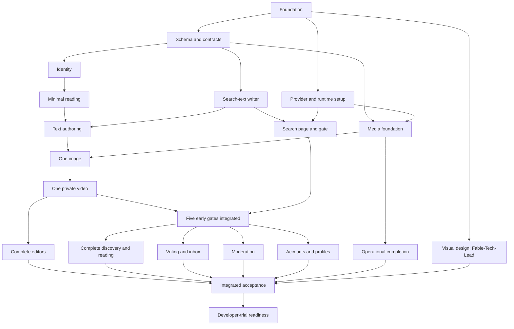

# Tips implementation plan

Date: 2026-09-20. Status: owner decisions agreed. Concrete tasks and execution policy are in [the task catalogue](task-index.md) and [agent workflow](agent-workflow.md). No application implementation has started.

## Outcome and owner decisions

Deliver the full agreed MVP ready for public developer trials, including deployment, recovery, moderation and operational checks. Demonstrate runnable journeys throughout development. There is no hard launch date or fixed execution/provider budget yet; order work by dependencies and risk rather than inventing a calendar estimate.

The current run is strictly serial, N = 1, per [agent-workflow.md](agent-workflow.md); the N = 2 and N = 4 material below is a historical planning option, not current process. The plan supports configurable **N implementation workers**, with schedules for 1, 2 and 4. Fable-Tech-Lead's role and Fable-TPM's technical-program-manager role are coordination responsibilities, separate from the requested worker count. The execution environment's total capacity still applies; N is a ceiling, not a requirement to keep every worker busy.

The owner selected **shadcn design language with native Phoenix components**, using **[SaladUI](https://github.com/bluzky/salad_ui) for now**. Visual design is assigned to **Fable-Tech-Lead or an Opus model**; Fable-Tech-Lead is the designated design owner. Retain Phoenix LiveView and HEEx. Design artifact work counts as a worker slot when it runs alongside implementation.

The existing product and technical decisions are the baseline:

- [Architecture](../design/technical/software-architecture.md): one Phoenix application and release, Accounts and Content contexts, LiveView, Postgres and Oban.
- [Data model](../design/technical/data-model.md): schema, visibility, constraints and concurrency invariants.
- [Backend](../design/technical/backend-design.md): operation contracts, authentication, providers and jobs.
- [Frontend](../design/technical/frontend-design.md): browser state, pages, drafts and recovery.

The three detailed contracts include the latest holistic consensus. Historical reviews and old SQL measurements are evidence and rationale, not alternative requirements. Where the architecture overview abbreviates a procedure, use its detailed owner document. Surface a genuine contradiction to Fable-Tech-Lead; do not silently choose whichever is easier.

The workspace contains designs and review experiments. Version control and the private GitHub tracker are established through the reviewed backlog baseline; the application and its acceptance gates remain unimplemented.

## Delivery approach

Start with a deployable skeleton and the risky end-to-end boundaries. Then expand the proven paths to the complete product. Each feature owner works through database, context, web and relevant tests; do not create permanent frontend/backend agent silos.

Keep the application architecture independent of the agent count. Agents share ordinary Phoenix contracts; they do not need separate services, runtime APIs, duplicated contexts or a custom workflow engine. Add internal modules when cohesive implementation needs them, not to manufacture parallel tasks.

Fable-Tech-Lead owns technical decisions, shared contracts, integration order and the integrated result. Fable-TPM owns dependency tracking, scope coverage, external prerequisites, demo evidence and release readiness. Neither role can call a feature done on the strength of an isolated agent's report. The owner supplies genuine seed experiences, recruits trial participants and makes material product, spending and public-launch decisions.

## Milestones

| Milestone | Demonstrable result | Exit evidence |
|---|---|---|
| M0 — Reproducible foundation | A fresh checkout starts the app with the pinned extension-enabled database; a release boots | Migrations, CI, browser-test plumbing and release health smoke pass |
| M1 — Boundaries proven | Sign in in another browser; publish/edit text after lost acknowledgement; retain one rejected image; upload/play/hide/delete one private video; run real hybrid search | All five early gates pass on integrated code before broad screen expansion |
| M2 — Complete product | Discover a technique, contribute a tip/review, vote, recover work, use profiles/inbox and moderate | Complete feature journeys and their failure cases pass |
| M3 — Operational rehearsal | Deploy/restart, recover jobs, restore a backup, detect stopped work and exercise providers | Rehearsal evidence on the intended deployment topology |
| M4 — Developer-trial ready | Founder and invited contributors can use the complete MVP through the public hostname | Release checklist, genuine seed content and owner launch decision |

A local provider stub can unblock implementation; it cannot pass a real-provider gate. A milestone with a blocked external check remains incomplete.

## Work packages and dependencies

The table defines delivery packages, not equal-duration tasks. Split each package into bounded child issues, each with one accountable owner; the package owner coordinates their composition. Packages are not fresh-session assignments. Unless a row distinguishes start and finish, a dependency means the prerequisite is integrated and its relevant gate passes. For a start/finish split, disjoint internals can be implemented against the settled contract at the start condition; integrated user-facing completion still requires every finish dependency. Do not merge a successful stub or count a mock as the missing integration.

| ID | Package and primary ownership | Depends on | Required result |
|---|---|---|---|
| P0 | Foundation — generator, dependency pins, CI, Compose/release baseline | — | Preserve project instructions; generate one Mix app; same pinned Postgres 18 extension image in CI and deployment; Oban/Swoosh foundation; isolated test setup and real-browser driver; initial health route; runnable release |
| P1 | Canonical migrations and boundary definitions — schemas, fixtures, shared declarations | P0 | Current constraints, triggers, indexes and auth-family/media/search fields; generated-auth adaptation agreed; tested shared Content visibility policy, projection types and operation result shapes; migrations run from empty DB |
| P2 | Identity and admission — Accounts and auth web flow | P1 | Signup/Turnstile, magic links, seven-day expiry/reclaim, family renewal/logout, current-session admission, abuse limits and another-browser return destination |
| P3 | Text authoring — Content core and tip/review editor owner | Start: P2. Finish: P4a, P9a | Text publish/edit/delete, normalized whole-intent comparator, self-votes and required notification/search writes, honest publication receipts, text draft CAS and lost-outcome recovery |
| P4a | Search-text writer — Search owner | P1 | Single normalized text builder and transactional writer; text freshness, vector invalidation and cooldown reset; tested contract ready for authoring |
| P4b | Search gate — same Search owner, including SearchLive | P4a, P13a | Exact pinned SQL and real searchable page, ten-query relevance fixture, one selected model/runtime, filtered recall, lexical nonmatches, stale-vector guard, concurrency/queue/deadline bounds and keyword fallback |
| P5 | Media foundation — Media provider/storage lifecycle and focused tests | Start: P1. Finish: P13a | Stable media identities, validation, ownership/claim rules, private Stream creation, R2 upload/cleanup, durable jobs, expiry/cooldown and signed access contract |
| P6 | One-image journey — editor owner with Media support | P3, P5 | Image survives a known rejection; submission and cleanup are correct after later-file failure and uncertain outcome; real R2 round trip |
| P7 | One-video journey — editor owner with Media support | P6 | Real private video reservation → transfer → completion → readiness → publication → playback → hide/delete; bounded status cycles and late-result guards |
| P8 | Complete editors and draft recovery — editor owner | P7 | Continue the proven editor path for both content kinds; all ordered mixed attachments and descriptions; motion previews; copy/paste/drop; full conflict recovery and publication-to-edit handoff; accessible controls |
| P9a | Minimal reading — discovery owner | P2 | Minimal readable tip/selected-review routes on database fixtures; page projections using the shared visibility policy, including deletion/hiding states needed by early slices |
| P9b | Complete discovery and reading — same discovery owner | M1 | Browse/filter URLs, readable initial HTML, complete tip/selected-review views, evidence and Back behavior; shared list/filter components integrated with SearchLive |
| P10 | Voting and inbox — interaction owner | M1 | Both vote directions, change/remove, folded notifications and captured-count read marking, summary/detail vote states, paged inbox and badge |
| P11 | Moderation — moderation owner | M1 | Reports, queue/case actions, reviewed-set/version guards, hide/restore, retag, selected media removal; full-ban/lift coordination with Accounts |
| P12 | Account lifecycle and profiles — account owner | M1 | Email change/sudo, account deletion including banned accounts, retained-author presentation, mixed contribution profiles and current capabilities |
| P13a | Early provider and runtime setup — operations owner | P0 | Secret loading, provider test configuration, production Compose baseline and provider access for the real early gates |
| P13b | Operational completion — same operations owner | P5 | Proxy/origin controls, independent progress check, sanitized error reporting, backup/restore/repair, moderator bootstrap and selected-job retry runbooks |
| P14 | Integrated adversarial acceptance — Fable-Tech-Lead plus feature owners | M1, P8, P9b, P10, P11, P12, P13b, P16 | Cross-feature races, browser failures, real providers, capacity fixtures, accessibility and complete developer journey on one integrated revision |
| P15 | Trial readiness and launch handoff — Fable-TPM plus owner | P14 | Deployment rehearsal, release checklist, genuine seed content, community guidance, operator ownership and developer-trial script |
| P16 | Visual design and shared UI — Fable-Tech-Lead, within N worker slots | P0 for component implementation | Pinned SaladUI integration, shadcn visual direction in native Phoenix components, design tokens and shared controls; responsive reader/editor compositions and validation/recovery states; visual consistency across all six page areas; final review of implemented screens |

P1 declares the search-text writer signature; P4a implements it in Search and integrates that small change before continuing to P4b. P3 calls it rather than duplicating it. P1 declares the normalized whole-content comparison contract; P3 implements it and P8 reuses it. P3 also supplies the transactional notification helpers and deletion/hiding primitives needed by early gates. P11 later adds the complete moderation workflow; P10 extends notification behavior and the inbox, without postponing publication correctness.

P1 defines public signatures, scope/admission shape, operation outcomes, projections, normalization ownership and test fixtures before dependent work forks. Put these declarations and examples beside actual code/tests; do not create a parallel specification that can drift. Select exact routes and a small set of shared components here. Implement helpers incrementally; an agreed signature is not permission to ship a successful stub.

P5 can implement and test provider/lifecycle logic against P1's account/scope contract while P2 implements authentication. Real privileged entry uses P2 admission before an early gate passes; test identities do not bypass production authorization. P9a's projection and reading code gives the editor a real post-save destination. It is a small early slice, not the full discovery interface.

M1 requires P2, P3, P4b, P5, P6, P7, P9a and their P13a environment. P4b permanently owns SearchLive, including the first search-to-result journey and later async/Retry behavior. P9b expands the reading pages and shared components. Keep broad screen expansion after M1 as the existing designs require; P8 can continue the already proven editor path after P7 while search closes its gate. Other spare capacity goes to bounded supporting hooks, tests and provider/operations work. P13b can progress before M1 as its job contracts become executable, and closes against the complete release before P14.

P16 starts early enough to guide shared components and the first reader/editor compositions. Functional boundary tests do not wait for visual polish. Fable-Tech-Lead owns shared styles/components/layouts during this work and hands their stable interfaces to the feature owners; follow the same exclusive-file rule for later changes. Target the initial visual baseline before broad screen expansion, then finish visual QA against the actual running journeys before P14. Do not add light/dark variants, a component catalogue or new control behavior merely because a toolkit offers them. Use SaladUI as the selected component source. Prefer its package/library integration initially; copy or adapt only concrete components that need source-level changes. Review setup-generated changes to the existing Tailwind configuration, styles, hooks and layouts rather than overwriting them blindly. Preserve the agreed native selects/details, page-owned uploads and server-rendered errors. The package must not become an alternative owner of draft, search or upload state.

SaladUI compatibility is a P0/P16 check: pin a released version or exact revision with compatible Phoenix/LiveView/Tailwind versions; render representative form controls, patch a LiveView and exercise reconnect, keyboard focus and validation. Verify its JavaScript integration alongside Tips hooks and that the CSS build includes dependency component classes. The upstream [README](https://github.com/bluzky/salad_ui#installation) and [dependency manifest](https://github.com/bluzky/salad_ui/blob/main/mix.exs) are setup inputs, not executed compatibility evidence. Keep visual changes focused on required screens; there is no hand-built general component library or React migration in this plan.

The graph shows completion dependencies; the table identifies where disjoint implementation may start earlier.

## Parallel execution and ownership

Use protected main and a separate branch/worktree per active bounded issue. Workers start from a known integrated commit. They do not edit each other's worktrees or merge each other's unfinished branches. Fable-Tech-Lead integrates one tested change at a time and resolves the final combined behavior. The owner selected the private chenghanlee/tips repository, GitHub Actions and the private Tips Project 15. Follow the agent workflow for independent commit/PR review and merge protection.

One worker owns a mutable file at a time. Package ownership includes its tests and fixtures. In particular:

- Fable-Tech-Lead coordinates `mix.exs`, lockfiles, router, supervision/configuration, CI and migration ordering. Workers request small changes through their task handoff; Fable-Tech-Lead integrates them promptly rather than making the user copy patches.
- One editor owner controls the editor LiveViews, upload configuration, shared draft hook and draft record format through P3/P6/P7/P8. Media workers supply the tested Media operations and adapters; they do not concurrently rewrite editor state. Preview, reorder, tus and Copy hooks may be delegated as bounded tasks with agreed DOM/event interfaces and distinct files. The editor owner integrates and browser-tests their combined behavior; these helpers count toward N.
- Search owns retrieval and embedding code. All publication/edit/retag callers use the single search-text write helper; changes to that contract require updating its callers and tests together.
- Accounts owns admission and session semantics. Content packages use the shared boundary rather than adding local token queries or inconsistent ban guards.
- Visibility and normalized content comparison have one implementation owner. Feature-specific projections and pages consume them. Fixes to a shared invariant include the affected callers in the same integrated change.

P1 owns the initial schema. Later migrations have a named owner, a unique order and an integration reservation; never have two workers independently redefine the same table or edit an already integrated migration. Run all migrations from empty DB after integration and rehearse the release migration command before launch. The product is greenfield; do not add legacy compatibility layers.

Every worktree has isolated build/dependency output where required, an isolated test database and a unique development port. Never run reset/drop tasks against another worker's DB. Tests that need independently committed concurrent transactions use dedicated fixtures/connections and explicit synchronization; ordinary sandboxed tests do not prove those schedules. Real-provider fixtures use distinct asset prefixes/identifiers and tracked cleanup.

GitHub issues hold current requirements, dependencies and evidence; the Tips project holds scheduling state. Use Backlog, Ready, Active, In review, Blocked and Done. Fable-TPM maintains task readiness and dispatch comments with owner/session, base commit, owned paths, isolation and evidence. The local task index links to the originally published issues; use GitHub for current task details. Do not build a scheduling service.

With N = 1, dispatch one task at a time. (Historical, for N > 1: dispatch at most `min(N, available worker slots, independent ready tasks)` workers.) A ready task has merged prerequisites, stable contracts, no conflicting file owner and the required environment. When those conditions fail, prefer finishing/reviewing a critical-path task to launching speculative work. Increasing N cannot remove serialized migrations, shared editor integration or release checks.

### Worked schedules

These are dependency-respecting examples, not time estimates. Move to the next ready package when its prerequisites pass; a row does not require equally sized work.

| Stage | N = 1 | N = 2 | N = 4 |
|---|---|---|---|
| Foundation | P0 → P1 → P16 baseline; Fable-Tech-Lead takes the single worker slot for design | A: P0/P1; B: Fable-Tech-Lead's P16 baseline after P0, with exclusive shared-file ownership | A: P0/P1; B: Fable-Tech-Lead's P16 baseline after P0; other slots handle bounded provider/build checks |
| First boundaries | P13a → P2 → P4a → P9a → P3 → P5 → P4b | A: P2 → P9a → P3; B: P13a → P4a → P5 → P4b; P3 finishes after integrated P4a | A: P2 → P3 internals; B: P4a → P4b; C: P5 internals; D: P13a → P9a after P2; finish dependencies still apply |
| Media integration | P6 → P7; integrate M1 | A owns P6 → P7; B: P13b and bounded supporting tests/hooks | A owns P6 → P7; B/C: assigned search/provider/hook acceptance gaps; D: P13b |
| Complete features | P8 → P9b → P10 → P11 → P12 → finish P13b | A: P8 → P11 → P12; B: P9b → P10 → finish P13b | A: P8; B: P9b → P10; C: P11 → P12; D: finish P13b and accepted hook/test tasks |
| Acceptance | P14 → P15 | Partition P14 scenarios by ownership, integrate, then P15 | Partition P14 scenarios by ownership, integrate, then P15 |

P16 final visual QA uses an available worker slot before P14; Fable-Tech-Lead never becomes an uncounted extra implementation worker. If its baseline remains active when another task is ready, queue that task or pause and hand off design explicitly. For N = 1, design and coding happen sequentially.

The longest expected authoring chain starts P0 → P1 → P2 → P9a → P3 → P6 → P7 → M1, with P4a and P5/P13a also required before their consumers. P4b is an independent gate that can become the critical path. After M1 the longest unfinished feature branch controls P14; estimate that only after observing actual delivery. Reuse idle workers for specific test/review tasks, not duplicated implementation or speculative abstractions.

## Acceptance ownership

Every package tests its own normal path, realistic failure and relevant concurrent schedule. P14 verifies their composition; it is not the first time testing occurs. Map the full acceptance lists in the three source documents to runnable test names or recorded manual evidence as implementation lands. Historical reduced-schema scripts are regression leads, not substitutes for application tests.

| Contract group | First owner | Combined evidence required |
|---|---|---|
| Auth/admission | P2, P12 | Cross-browser return without replay; seven-day lock-wait deadlines; both renewal/logout orders, late cookies, other browser, sudo recency, failed disconnect, account switch and email change |
| Transactions and visibility | P1, P3, P11 | Full schema/trigger/FK lock graph; publication versus ban; report/delete both orders; independent reviews under hidden/deleted tips; no title/slug/excerpt/media leaks |
| Save acknowledgement and drafts | P3, P8 | Same-key different/unknown intent; only equivalent submitted revision clears; CAS races; lost edit result; complete-base conflict path; K/E draft coexistence; image/video handoff without re-upload |
| Media and jobs | P5–P8, P13b | Limits/ownership; later-image failure; private playback; attach/expiry/cleanup races; fifty uncertain rows do not starve later rows; late responses; identifiers survive job pruning; real provider checks |
| Search | P4a/P4b, P9b | Ten task queries; both extensions; zero lexical matches; retag versus embedding; exact filters/visibility; bounded ranking/fallback; cancelled and stale tasks; queue saturation and total deadlines |
| Votes/reviews/inbox | P3, P10 | Exactly-once database effects under retries; count triggers; self-votes; fold/read race; review edits do not replay notifications; one active review rule |
| Reading/navigation | P9a/P9b, P12 | Readable initial HTML; filters and submitted query preserved; selected-review mode; pagination/Back; profiles; current author capabilities including banned-author deletion |
| Moderation | P11 | Reviewed report set, fresh reports, content version guards, no accidental restoration/unban vote recreation; atomic ten-thousand-review fixture with concurrent votes |
| Browser usability | P8, P9b, P10–P12 | Actual IndexedDB/hooks, reconnect and storage failure; keyboard ordering/focus; 320px reflow/zoom; ten delayed attachments and thirty full maximum-size reviews |
| Operations | P13a/P13b, P14/P15 | Release deploy/migrate/restart, rescue/drain, backup restore, repair, separate web/DB and background-progress probes, secrets and error redaction, proxy/rate controls |

Run formatting, compilation/static checks and relevant tests per change. The integrated branch runs the full automated suite in its pinned environment. Provider staging checks and deployment rehearsals record environment, revision, result and cleanup. A failing or unavailable required check is visible as blocked; do not mark it passed because a fake succeeded.

## External prerequisites and readiness

Track access, owners, consuming issues and next actions in the [external prerequisite matrix](prerequisites.md).
Fable-TPM starts a concise prerequisite checklist during P0: Git/CI destination; VPS and domain; Cloudflare proxy, Turnstile, R2/media delivery and private Stream configuration; email provider and sender domain; selected embedding access; Sentry/error and uptime monitoring. Request credentials through the execution environment's secret mechanism, never through committed documents or chat transcripts. Assign an owner and needed-by package to each missing item. P13a must unblock real-provider gates before M1, not wait for feature completion. Track the curated technique/model/environment rows needed before P3; propose a small initial vocabulary for owner review, always including Other technique. Tests use explicit fixtures while production labels are settled.

Pin compatible framework, library, database-extension and provider API versions during P0/P1 and verify the official documentation then. The design references are not proof that an arbitrary newest combination works. If a compatible published database image is unavailable, building and verifying it is P0 work and an immediate schedule risk. Choose and execute the real-browser test driver in P0, not after draft hooks are written. Evaluate the hosted embedding candidate first under the existing gate; use the documented fallback only when the gate warrants it. Do not silently substitute keyword-only search or omit native video from the full MVP.

The ten-query search gate needs representative developer tasks and relevance expectations before tuning. Use the agreed first scenario: a coding agent making a correct scoped change without unrelated edits. Label synthetic fixtures as synthetic; production seed experiences come from their actual authors through normal forms. Fable-TPM tracks founder/contributor readiness alongside engineering, without blocking schema or local feature work.

Provide a release-only, explicit moderator-bootstrap command for a verified account; record the designated operator rather than exposing role selection in signup. Measure deployment interruption in the rehearsal instead of promising a duration.

The release checklist includes current community guidance, contributor/moderator access, deployment interruption behavior, sanitized monitoring, seven-day private backup retention with successful restore, exhausted-job recovery, cache/purge checks and noindex. Retain noindex until direct sharing reaches the already agreed twenty non-staff visitors in one week; the operator checks weekly. Do not invent an analytics platform to satisfy this check.

Public signup remains open after email verification. Personal trial invitations do not introduce invitation codes or approval queues. Product success is evaluated through observed developer trials and firsthand reports; technically passing tests does not establish product-market fit.

## Task handoff and completion

Use the [agent workflow](agent-workflow.md) for readiness, review evidence, git isolation, handoff and milestone gates. The catalogue refines the package schedule into executable dependencies. An unknown signature or test command must be resolved before its issue becomes Ready.

Give each worker this compact brief:

> Implement bounded issue [ID] from integrated commit [SHA]. Read AGENTS.md and the linked owning design sections. Own [paths]; coordinate [shared paths] through Fable-Tech-Lead. Prerequisites: [passed gates]. Deliver [user-visible behavior] and preserve [critical invariants]. Verify [specific tests/failure schedules]. Return commit(s), changed contract(s), evidence and unresolved blockers. Do not expand product scope or modify another worker's files.

A package is integrated only when its behavior works against the current combined application, its relevant tests pass, direct/downstream effects are reviewed and its linked acceptance items have evidence. Fable-Tech-Lead merges and reruns checks affected by the combined change. Fable-TPM records the evidence and next dependency, rather than asking the user to reconcile agent outputs.

If a contract must change, Fable-Tech-Lead traces the affected database, context, browser and operational paths before integration. Update the authoritative design and all affected callers/tests in the same reviewed change. Escalate material product or cost choices to the owner; resolve routine reversible coding details within the agreed design.

## Planning review

Owner answers recorded: configurable N (1/2/4 examples), full developer-trial-ready MVP, no hard deadline or fixed budget, Fable/Opus visual ownership, native Phoenix with shadcn design language, and SaladUI selected for now. The [Codex/Fable planning review](../brainstorm/implementation-plan.md) records five rounds of proposals, corrections and final agreement; this document is the canonical plan.

Consensus includes early provider setup, Search-owned text writing, separate start/finish dependencies, a small early reading slice, continued editor work while search completes, explicit visual-design ownership and package-mode SaladUI with selective customization. The 20-package dependency graph is acyclic; local links and anchors were checked. The owner confirmed shared understanding and authorized Codex/Fable to establish the actionable backlog. Every commit and complete PR require independent review before merge; repair continues until acceptance passes and no P0/P1 remains. Context overrun continues on the same issue in a fresh repair session. No application, provider integration or release gate has yet been implemented or validated.
